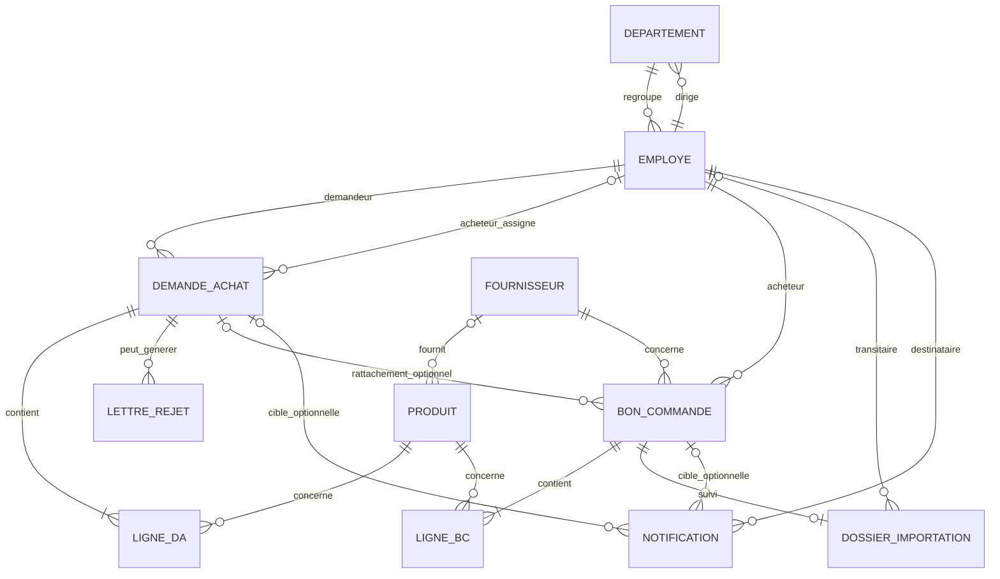

# Analyse technico-fonctionnelle — SUIVI PROCESS ACHAT TELECOM

> **Périmètre et méthode.** Cette analyse décrit le dépôt versionné tel qu'il a été lu, sans modifier le code applicatif. Les conclusions sont issues d'une lecture statique du frontend, du backend, des migrations, des configurations et de la documentation suivie. Aucune fonctionnalité n'est déclarée testée à l'exécution. Les chemins cités sont relatifs à la racine du dépôt. Les dossiers de dépendances (`frontend/node_modules`, `backend/.venv`) et artefacts générés ne sont pas des sources métier.

## 1. Résumé et objectif

Le projet est une application web de suivi d'achats pour un contexte télécom. Son noyau persistant couvre :

1. la création et la consultation des demandes d'achat (DA) et de leurs lignes ;
2. l'assignation d'un acheteur, l'approbation ou le rejet ;
3. le regroupement des lignes approuvées par fournisseur et la création de bons de commande (BC) ;
4. la création d'un dossier d'importation par BC, l'assignation d'un transitaire, quelques données d'importation et la validation de réception ;
5. des notifications persistées pour certains événements.

Le noyau n'implémente pas un workflow complet uniformément contrôlé. Plusieurs écrans visibles — documents de transport, assurance, suivi, historique et espace contrôleur — sont des démonstrations en mémoire sans API associée. Le dossier d'importation ne stocke pas les fichiers de transport, les certificats d'origine, les listes de colisage, l'assurance ou les événements de transport. Il existe aussi un écran de création de BC qui ne persiste pas de commande, distinct de la génération API appelée depuis le regroupement.

Le README qualifie explicitement le projet de travail en cours. Les spécifications détaillées, diagrammes UML/MCD/MLD et tests métier attendus ne sont pas présents dans le dépôt suivi, hormis des répertoires placeholders et une note de configuration départementale.

## 2. Architecture technique

### Frontend

- React 18 + JavaScript, Vite 5, React Router 6 et Tailwind CSS 3 (`frontend/package.json`, `frontend/vite.config.js`).
- Le routeur est centralisé dans `frontend/src/App.jsx`. Les pages sont pour l'essentiel chargées paresseusement et montées sous `MainLayout`.
- `AuthContext.jsx` maintient la session; `services/api.js` configure Axios et le renouvellement JWT; `constants/roles.js` fournit navigation et autorisation de routes côté client.
- Les écrans et composants sont sous `frontend/src/pages/` et `frontend/src/components/`; les fonctions de formatage et de validation sont sous `frontend/src/utils/`.
- `pdf-lib` est utilisé par `utils/bcPdf.js` et `utils/daPdf.js`. Le proxy Vite transmet `/api` vers Django sur le port 8000, tandis que Vite sert le frontend sur le port 3000.
- Les pages appellent souvent Axios directement. `hooks/useApi.js` existe, mais ne constitue pas l'abstraction API uniforme. `constants/api.js` et `constants/routes.js` contiennent des routes génériques qui ne reflètent pas la majorité des endpoints effectivement appelés.

### Backend

- Django + Django REST Framework, organisé en cinq applications : `authentication`, `produits`, `demandes`, `commandes`, `notifications`.
- `backend/config/urls.py` regroupe ces applications sous `/api/`; les routes applicatives sont déclarées dans leurs `urls.py` avec des `DefaultRouter` et des actions DRF.
- Les modèles Django sont déclarés `managed=True` et définissent notamment des noms de tables hérités (`Employé`, `BonDeCommande`, `Ligne de BonDeCommande`, etc.). Les migrations sont le mécanisme de schéma suivi.
- DRF utilise l'authentification personnalisée `authentication.jwt.EmployeJWTAuthentication` et `IsAuthenticated` comme permission par défaut (`backend/config/settings.py`). La pagination est optionnelle : sans `?page=`, les listes répondent sous forme de tableaux; avec `page`, la réponse est paginée par `OptionalPagination`.
- La configuration charge `backend/.env`; les clés de configuration BD référencées sont `DB_NAME`, `DB_USER`, `DB_PASSWORD`, `DB_HOST`, `DB_PORT`. Aucune valeur de secret ou valeur d'environnement n'est reproduite dans cette analyse.
- Le moteur configuré est PostgreSQL, avec options de connexion SSL et pool. Le README mentionne Supabase comme environnement de développement, mais aucune instance distante n'a été inspectée ni testée.

### Configuration et outillage

- Dépendances backend déclarées dans `backend/requirements.txt`; frontend dans `frontend/package.json` et `package-lock.json`.
- Les commandes usuelles sont données dans `README.md`; les scripts frontend déclarés sont `dev`, `build`, `lint`, `preview`.
- `backend/config/settings.py` contient des paramètres qui ne sont pas adaptés à la production (notamment mode debug et configuration de clé/hosts). Il s'agit d'un constat de code, pas d'une évaluation du déploiement réel.
- `backend/restore.log` rapporte une restauration SQL ayant échoué faute de fichier source référencé; il ne permet pas de conclure sur l'état actuel d'une base.

## 3. Acteurs et permissions

Les rôles métier sont définis dans `authentication.models.Employe.Role` et repris par `frontend/src/constants/roles.js`. **Les rôles du menu ne forment pas une frontière de sécurité serveur** : le backend ne définit pas une permission dédiée par rôle pour la plupart des opérations.

| Rôle | Rôle fonctionnel observable dans le code | Accès frontend | Contrôle serveur observé |
|---|---|---|---|
| `demandeur` | Créer et consulter ses demandes; éditer une demande non assignée. | Liste et formulaire DA. | `DemandeAchatViewSet.get_queryset()` filtre les DA du demandeur connecté. La création fixe l'identité depuis la session. Les autres appels sont toutefois surtout protégés par authentification, sans matrice de rôles homogène. |
| `chef département` | Consulter les demandes de son département et, depuis la liste, assigner un acheteur. | Demandes et BC. | La liste DA est filtrée par `id_demandeur__id_departement__id_chef`. L'action d'assignation est accessible à tout utilisateur authentifié côté vue, sans vérification de rôle métier explicite rapportée. |
| `acheteur` | Traiter des demandes assignées, les approuver/rejeter, regrouper des demandes approuvées, produire des BC et suivre ses dossiers. | Demandes, approuvées, regroupement, BC. | La liste DA est filtrée par acheteur. L'action d'assignation de transitaire et les opérations de dossier ont des vérifications plus précises; approbation/rejet, regroupement et génération n'imposent pas toutes un rôle acheteur côté serveur. |
| `transitaire` | Prendre en charge un dossier d'importation assigné, renseigner certaines informations et valider une réception. | Tableau de bord, dossiers, documents transport, assurances, suivi, réception, historique. | Les dossiers sont filtrés par assignation. Les opérations de modification/réception vérifient l'assignation du transitaire. Une partie importante de ses pages n'utilise cependant pas l'API. |
| `controleur` | Interface de vérification de dossiers et lettres de crédit simulées. | Tableau de bord, dossiers à vérifier, vérifiés, lettres. | Aucun modèle ou endpoint contrôleur / lettre de crédit identifié. Le contexte et ses mutations sont locaux au navigateur. |
| `admin` | Tableau de bord et consultation des données de gestion affichées dans l'interface. | Dashboard, utilisateurs, demandes, BC, produits, fournisseurs. | Aucun contrôle d'administrateur universel côté API; les vues exigent généralement une authentification, pas le rôle admin. Le CRUD utilisateurs annoncé est limité par le serializer en lecture seule. |
| `directeur` | Accès au tableau de bord administratif uniquement. | `/admin`. | Même API que les autres rôles authentifiés; aucune permission distincte de directeur observée. |

`MainLayout` redirige les utilisateurs sans session vers `/login` et contrôle les chemins via `isPathAllowed`. Ce garde est exclusivement frontend et n'empêche pas l'appel direct d'un endpoint. `/profile` est admis pour tous les rôles par le helper. La navigation est définie dans `ROLE_ACCESS`; elle ne doit pas être interprétée comme la politique réelle de l'API.

### Authentification et notifications globales

- Connexion : `POST /api/auth/login`, données `{ email, mot_de_passe }`; récupération du profil : `GET /api/auth/me`; renouvellement : `POST /api/auth/refresh`; déconnexion : `POST /api/auth/logout`.
- Le backend émet des JWT d'accès et de refresh; l'identifiant JWT est `id_emp`/`user_id`. Les comptes archivés sont refusés à la connexion. Le logout répond côté API, mais ne révoque pas le refresh token côté serveur.
- Le frontend conserve les tokens en `localStorage`; Axios les transmet et tente un refresh sur 401. `logout()` côté frontend efface localement les tokens.
- La barre supérieure charge les notifications, permet de marquer une notification ou toutes comme lues; les clics conduisent à la DA ou au BC lié lorsque la cible existe. Les notifications sont destinées à un employé et les vues filtrent par destinataire.

## 4. Écrans, rôle par rôle

Les écrans sont définis par `frontend/src/App.jsx`; la navigation par rôle est définie par `frontend/src/constants/roles.js`. Les indicateurs calculés côté interface peuvent agréger les résultats API, mais ne sont pas nécessairement des rapports serveur ni des validations métier.

### Admin

| Écran | Utilité et données | Actions, origine et résultat réel |
|---|---|---|
| `/admin` — `AdminDashboard` | Synthèse des demandes, BC, utilisateurs et produits, avec compteurs/visualisations calculés à partir des listes. | Charge `GET /api/demandes/`, `/api/bons-commande/`, `/api/users/`, `/api/produits/`, `/api/fournisseurs/`. C'est une agrégation frontend, soumise aux filtres/permissions effectifs de chaque liste. |
| `/admin/users` — `AdminUsers` | Liste d'utilisateurs avec informations d'identité/rôle/état. | Requête utilisateurs; données mock affichées en secours si la réponse échoue ou est vide. Le serializer Employe est en lecture seule : ne pas considérer la présentation CRUD comme un CRUD serveur fonctionnel. |
| `/admin/demandes` — `AdminDemandes` | Tableau de consultation des DA et leurs statuts. | Appel API demandes; l'échec est montré comme erreur, sans fallback mock. La portée effective des données dépend du queryset filtré par rôle du compte connecté. |
| `/admin/bons-commande` — `AdminBonsCommande` | Consultation de BC. | Appel API BC; fallback de démonstration si erreur ou liste vide. |
| `/admin/produits` — `AdminProduits` | Consultation catalogue produit. | Appel API produits; fallback mock si erreur ou liste vide. Le modèle ne porte pas de catégorie; un formulaire de catégorie présent ailleurs ne prouve pas une API catégorie. |
| `/admin/fournisseurs` — `AdminFournisseurs` | Consultation des fournisseurs. | Appel API fournisseurs; fallback mock si erreur ou liste vide. Le backend expose le modèle fournisseur mais aucun contrôle d'accès admin spécifique. |
| `/admin/settings` — `AdminSettings` | Formulaire de réglages présenté dans l'interface. | Route déclarée mais non incluse dans la navigation ni dans les chemins explicitement autorisés de `ROLE_ACCESS`; l'utilisateur admin est donc redirigé par `MainLayout`. Le bouton d'enregistrement n'a pas de handler/API. |

Le rôle `directeur` ne voit dans sa navigation que `/admin`. Son écran est le même dashboard, et les autres pages admin ne lui sont pas autorisées par le garde frontend.

### Demandeur, chef de département et acheteur — demandes

| Écran | Utilité et données | Actions, origine et résultat réel |
|---|---|---|
| `/purchases/requests` — `PurchaseRequestList` | Liste DA avec référence, demandeur, objet, date, statut et filtres locaux; fonctions variables selon rôle. | `GET /api/demandes/`; l'acheteur peut aussi charger les DA approuvées et les BC. Le demandeur voit les siennes, acheteur ses DA assignées, chef celles des demandeurs de son département selon le queryset backend. Le chef peut assigner un acheteur par `POST /api/demandes/{id_da}/assigner_acheteur/`. Un bouton de suppression appelle `DELETE /api/demandes/{id_da}/`; cela supprime la DA selon l'API, pas seulement de la liste. |
| `/purchases/request/new` et `/purchases/request/:id` — `PurchaseRequest` | Formulaire de création/modification; charge catalogue et, en édition, la DA. Champs observés : DOT, objet, lignes produit/quantité/prix. | `GET /api/produits/`, `GET /api/demandes/{id}/`, puis `POST /api/demandes/` ou `PATCH /api/demandes/{id}/`. Le backend demande au moins une ligne, fixe le demandeur connecté et génère un numéro de DA si absent. L'édition backend est refusée lorsque la DA est assignée. Validation quantitative/prix et atomicité des lignes sont insuffisamment garanties côté serveur. |
| `/purchases/request/:id/fiche` — `FicheDemande` | Détail DA, lignes, statut et dates; fiche d'information pour décision/consultation. | L'approbation appelle `POST /api/demandes/{id_da}/accepter/`; le rejet appelle `POST /api/demandes/{id_da}/rejeter/` avec `{ motif }`. Une lettre de rejet peut être créée si un motif est fourni. Pas de transition serveur stricte garantissant le rôle ou le statut précédent. L'acheteur peut choisir une lettre de rejet via `RejectionLetterForm`; l'écran de liste de lettres n'est pas routé. |
| `/purchases/approved-requests` — `DemandesApprouvees` | File des DA approuvées n'ayant pas encore de BC lié, selon filtre frontend. | Charge les DA et les BC puis filtre localement `approuvee` / absence de BC. La disponibilité de cette vue ne garantit pas le verrouillage serveur d'une DA déjà regroupée. |
| `/purchases/regroupement` — `Regroupement` | Prépare des paniers à partir de DA approuvées et regroupe les lignes par fournisseur; consultation fournisseur. | `POST /api/regroupement/` avec `{ ids_da }`, `GET /api/fournisseurs/`, puis `POST /api/bons-commande/generer/` avec `{ paniers }`. La logique de regroupement backend prend les DA approuvées sans BC et consolide par fournisseur. Le endpoint de génération n'impose pas à lui seul la vérification du rôle acheteur. |

### Acheteur et transitaire — bons de commande / dossier

| Écran | Utilité et données | Actions, origine et résultat réel |
|---|---|---|
| `/purchases/orders` — `PurchaseOrderList` | Liste de BC, référence, fournisseur, date, statut et montants disponibles. | `GET /api/bons-commande/?page=...&page_size=...`; export unitaire ou groupé par PDF. L'export groupé recharge jusqu'à 200 lignes côté frontend. Les droits de visibilité BC sont moins stricts que les listes DA. |
| `/purchases/order/:id/fiche` — `FicheBonCommande` | Fiche BC et dossier d'importation : fournisseur, acheteur, lignes, tarif douanier, autorisation, mode/lieu de transport, date prévue/réelle, statut. | Lectures `GET /api/bons-commande/{id}/`, `/api/dossiers-importation/`, `/api/users/`. L'acheteur peut assigner un transitaire via `POST /api/dossiers-importation/{id_dossier}/assigner_transitaire/`; la vue vérifie rôle/état du transitaire et propriétaire acheteur. Mise à jour dossier par `PATCH /api/dossiers-importation/{id_dossier}/` avec les champs présents au modèle; la modification est limitée au transitaire assigné selon la vue. Réception API via `POST /api/dossiers-importation/{id_dossier}/valider_reception/`. |
| `/purchases/order/new` ou `/purchases/order/:id` — `PurchaseOrder` | Formulaire visuellement destiné à créer/éditer un BC. | Produits et fournisseurs sont codés en dur; la soumission fait un `console.log` et n'appelle aucun endpoint. Cet écran n'est pas le flux de génération BC réel, qui se trouve dans `Regroupement`. |
| `FicheBonCommande` — PDF | Génération du bon de commande à partir d'un gabarit PDF versionné sous `frontend/public/Bon_de_Commande.pdf`. | `utils/bcPdf.js` remplit le gabarit à l'aide de `pdf-lib`. C'est une génération locale; le backend ne génère ni ne stocke le PDF. |

### Transitaire — pages dédiées

Le menu présente une couverture de processus plus large que le modèle et l'API. Le dossier persistant a une relation 1:1 avec un BC et ne conserve que des champs de suivi d'importation simples (`tarif_douane`, autorisation, mode, lieu, dates, statut, transitaire).

| Écran | Contenu affiché | Actions et persistance |
|---|---|---|
| `/purchases/dashboard` — `TransitaireDashboard` | Compteurs et dossiers récents issus de `GET /api/dossiers-importation/`; comporte aussi un indicateur de documents manquants alimenté par les dossiers statiques de `DocumentsTransport`. | Le total/statut récent suit l'API; le compteur de pièces manquantes n'est pas un état serveur. |
| `/purchases/dossiers` — `DossiersImportation` | Liste/recherche locale et filtres par statut/retard; ouvre la fiche BC liée. | `GET /api/dossiers-importation/`. Les filtres sont côté navigateur. Dates/statuts affichés viennent du dossier API, mais les fichiers et le détail documentaire ne sont pas disponibles dans ce modèle. |
| `/purchases/documents-transport` — `DocumentsTransport` | Échantillons de dossiers et liste de pièces : lettre de transport maritime/aérienne/terrestre, facture commerciale, liste de colisage, certificat d'origine, connaissement; statuts « fourni », « manquant », « à vérifier », champs d'écarts et métadonnées. La recherche filtre référence, fournisseur et mode. | Les quatre dossiers et leurs données sont des constantes `DOSSIERS` (exemples datés 2026). « Importer » vérifie seulement le numéro du document et modifie l'état React local; le champ `fichier` ne transmet pas de fichier. Aucun endpoint, `FormData`, stockage ou accès fichiers backend n'existe. La cohérence documentaire n'est donc pas vérifiée par l'application persistante. |
| `/purchases/assurances` — `Assurances` | Tableau d'assurances par dossier, fournisseur, type/dates et statut selon les valeurs initiales de la page. | État initial et changements locaux; aucun endpoint/modèle assurance. Un rechargement perd la mutation. |
| `/purchases/suivi-transport` — `SuiviTransport` | Étapes d'expédition et indicateurs de progression avec dates/événements préremplis. | Chronologie de démonstration; aucune table d'événement transport ni API permettant de suivre un envoi. |
| `/purchases/reception` — `ReceptionColis` | Tableau contenant BC, fournisseur, « date réception (acheteur) », nombre de colis, statut, action de validation. | Données `INITIAL_COLIS`; clic change uniquement le statut local. Pour la réception persistée, la fiche BC appelle `valider_reception` sur le dossier. Le nombre de colis et la date de cette table ne sont pas enregistrés par ce bouton. |
| `/purchases/historique` — `Historique` | Recherche sur un historique statique de BC livrés, tarif et date. | Liste constante sans appel API; la clôture/historique serveur n'est pas implémenté. |

#### Focalisation demandée : dossier transitaire

- **Bons de commande, fournisseur, mode et dates** : le BC et le fournisseur sont persistés dans les modèles `BonDeCommande`/`Fournisseur`; le mode et dates existent sur `DossierImportation`, accessibles par les endpoints de dossier et la fiche.
- **Statut** : le modèle dossier déclare `a traiter`, `en cours`, `livré`. Le front affiche parfois d'autres valeurs dans ses jeux de démo (`a_valider`). La réception API passe le dossier à `livré`.
- **Documents manquants, certificat d'origine, liste de colisage** : ces types et états n'existent que dans les objets de démonstration `DOSSIERS` de `DocumentsTransport.jsx`. Aucun document uploadé n'est stocké.
- **Dossier d'importation, documents de transit, assurance, suivi de transport, réception des colis, historique** : le seul dossier persistant est celui de `commandes.DossierImportation`. Assurance, événements, transporteur, colis, réception partielle et historique événementiel sont absents des modèles et endpoints.
- **Réception** : distinguer le bouton local de `/purchases/reception` de l'action backend `valider_reception` depuis la fiche BC. Cette dernière vérifie l'affectation au transitaire, renseigne la date de réception réelle, met le dossier à `livré` et déclenche des notifications selon le code.

### Contrôleur

| Écran | Utilité et données | Résultat réel |
|---|---|---|
| `/controleur` — `ControleurDashboard` | Compteurs/récapitulatif dossiers et lettres issus de `ControleurContext`. | État local initial, pas de requête API. |
| `/controleur/dossiers` — `ControleurDossiers` | Présente montants BC, tarif, autorisation, mode, lieu et statut de vérification. | `verifier(bc)` change l'état React, ajoute une lettre de crédit synthétique et affiche une alerte; aucun contrôle métier serveur/document bancaire. |
| `/controleur/verifies` — `ControleurVerifies` | Liste des dossiers dont le statut local est vérifié. | Dépend de `INITIAL_DOSSIERS` et de la session frontend; rechargement réinitialise les valeurs. |
| `/controleur/lettres` — `ControleurLettres` | Liste de lettres de crédit simulées avec numéro, BC, fournisseur, montant, banque/date. | `INITIAL_LETTRES`/état local; aucun modèle, endpoint, génération PDF ou connexion bancaire. |

### Profil, navigation et composants transverses

- `/profile` affiche les données du compte (route disponible quel que soit le rôle). L'authentification est fournie par `AuthContext`.
- `Sidebar` affiche `ROLE_ACCESS[role].nav`; `TopBar` présente les notifications et actions de lecture.
- Les composants communs `DataTable`, `StatusBadge`, `Stepper`, `ConfirmDialog`, `FormField`, `Select` et les formulaires de `components/forms/` structurent l'UI. La présence d'un formulaire (catégorie, facture, livraison, stock, produit, fournisseur, utilisateur) ne signifie pas qu'un parcours API correspondant est routé.
- `FicheDemande`/`daPdf.js` produisent une fiche DA locale; `bcPdf.js` produit les PDF BC à partir du modèle public. Aucun endpoint PDF backend n'a été identifié.
- `RejectionLetterList.jsx` n'est branché à aucune route de `App.jsx`; ne pas le confondre avec les lettres simulées du contrôleur.

## 5. Pipeline métier réellement codé

### Diagramme

```mermaid
flowchart TD
    A[Demandeur : saisir DA + lignes] --> B[POST /api/demandes/]
    B --> C[DA en_cours persistée + notification au chef si département identifié]
    C --> D{Chef de département}
    D -->|Assigne acheteur| E[POST /api/demandes/{id}/assigner_acheteur/]
    D -->|Pas d'assignation| X[DA reste en_cours / blocage manuel]
    E --> F[Notification à l'acheteur]
    F --> G{Acheteur : décision}
    G -->|Approuver| H[POST /api/demandes/{id}/accepter/]
    G -->|Rejeter avec motif| I[POST /api/demandes/{id}/rejeter/]
    I --> J[statut refusee + lettre de rejet si motif + notification demandeur]
    G -->|Rejeter sans motif| K[statut refusee sans nouvelle lettre]
    H --> L[statut approuvee + notification demandeur]
    L --> M[Regroupement des DA approuvées sans BC par fournisseur]
    M --> N[POST /api/bons-commande/generer/ avec paniers]
    N --> O[BC + lignes BC + dossier importation créés]
    O --> P[Assignation transitaire par acheteur propriétaire]
    P --> Q[Notification transitaire]
    Q --> R[Transitaire modifie champs disponibles du dossier]
    R --> S[POST valider_reception]
    S --> T[statut livré + date réception réelle]
    T --> U[Notifications acheteur et demandeur]
    U --> V[Fin du seul flux API persistant observé]
    O -. PDF généré localement .-> W[Export PDF BC côté navigateur]
    O -. écrans de démonstration sans persistance .-> Z[Documents / assurance / suivi / historique / contrôleur]
```

### Étapes, données et suites

| Étape | Responsable et action | Données / règle observée | Écran, endpoint, modèle | Suite / limite |
|---|---|---|---|---|
| 1. Création DA | Demandeur saisit objet, DOT et lignes produit/quantité/prix. | Au moins une ligne requise; le demandeur vient de `request.user`; numéro auto `DA-année-nnnn` si absent; statut initial `en_cours`. | `PurchaseRequest`; `POST /api/demandes/`; `DemandeAchat`, `LigneDemandeAchat`. | Notification éventuelle au chef du département. Pas de circuit de soumission distinct du POST. |
| 2. Notification/visibilité chef | Le système retrouve le chef de département du demandeur; le chef consulte la file départementale. | Le filtrage dépend de `Employe.id_departement` et `Departement.id_chef`; le code n'utilise pas simplement la DOT. | `GET /api/demandes/`; `Notification`; relations Employe/Departement. | Si aucun département/chef n'est affecté, la règle de notification/prise en charge ne garantit pas un destinataire. |
| 3. Assignation acheteur | Chef choisit un acheteur dans la liste des employés. | Enregistre `id_acheteur` et `date_assignation`; notification à l'acheteur. | `PurchaseRequestList`; `POST /api/demandes/{id}/assigner_acheteur/`; `DemandeAchat`. | L'action est exposée sans permission de rôle métier explicite dans la vue. |
| 4. Approbation | Acheteur décide d'accepter. | Statut `approuvee`, date d'approbation; notification au demandeur. Aucun garde de transition strict rapporté. | `FicheDemande`; `POST /api/demandes/{id}/accepter/`; `DemandeAchat`. | Rejoindre la file de demandes approuvées. |
| 5. Rejet | Acheteur refuse et peut saisir un motif. | Statut `refusee`, date de rejet; notification demandeur. Si motif non vide, création de `LettreRejet`; le motif n'est pas obligatoire pour l'action. | `FicheDemande`; `POST /api/demandes/{id}/rejeter/`; `DemandeAchat`, `LettreRejet`, `Notification`. | Branche terminée au niveau DA; lettre de rejet non reliée à un écran de liste actif. |
| 6. Regroupement | Acheteur sélectionne des DA approuvées à traiter. | L'action backend extrait les lignes et consolide les paniers par fournisseur; l'interface enlève celles déjà associées à un BC lorsqu'elle connaît les BC. | `Regroupement`; `POST /api/regroupement/`; DA, lignes, produit, fournisseur. | L'API de regroupement/génération ne se fonde pas uniquement sur une sélection auditée côté serveur. |
| 7. Génération BC | Acheteur confirme les paniers. | Crée BC, lignes BC et un `DossierImportation` par BC; référence BC calculée avec année/id; contrainte unique fournisseur/date/acheteur. Le lien DA est optionnel. | `POST /api/bons-commande/generer/`; `BonDeCommande`, `LigneBonDeCommande`, `DossierImportation`. | Pas de transaction atomique pour les créations en lot; la liaison DA peut être ambiguë pour les paniers multi-DA. |
| 8. Export BC | Acheteur ou lecteur de la page exporte le BC. | PDF produit localement à partir du gabarit; le backend ne conserve pas de fichier de commande. | `PurchaseOrderList`/`FicheBonCommande`; `bcPdf.js`, `pdf-lib`, ressource publique. | Aucun journal d'export ou version de document côté serveur. |
| 9. Prise en charge dossier | Acheteur propriétaire du BC sélectionne un employé transitaire actif. | Vérification rôle transitaire/état actif et ownership de l'acheteur; date/statut mis à jour selon l'action; notification au transitaire. | Fiche BC; `POST /api/dossiers-importation/{id}/assigner_transitaire/`; `DossierImportation`, `Notification`. | Aucune assignation à une équipe, historique d'assignation ou échéance obligatoire. |
| 10. Données d'importation | Transitaire assigné renseigne les données exposées. | Tarif douanier, autorisation nécessaire/obtenue/numéro, mode, lieu de chargement, date prévue. Mise à jour persistée; notification à l'acheteur selon helper. | Fiche BC; `PATCH /api/dossiers-importation/{id}/`; `DossierImportation`. | Pas de dépôt documentaire, vérification de certificat, assurance, transporteur/événement/colis. |
| 11. Réception | Transitaire assigné valide la réception depuis la fiche BC. | Enregistre date réelle, statut `livré`; notification acheteur et demandeur. Pas de détail de quantité reçue, réserves ou réception partielle. | `POST /api/dossiers-importation/{id}/valider_reception/`; `DossierImportation`, `Notification`. | C'est la seule clôture proche d'une fin persistée; pas de statut BC final ni d'étape post-réception identifiée. |
| 12. Transit étendu / contrôleur | Les écrans affichent documents, assurance, étapes de transport et lettres de crédit. | Constantes et état React; aucune validation métier ni persistance. | `DocumentsTransport`, `Assurances`, `SuiviTransport`, `ReceptionColis`, `Historique`, `ControleurContext`; aucun endpoint correspondant. | Ce parcours ne peut pas être présenté comme la suite opérationnelle réelle du workflow. |

### Variantes, retours et blocages

- **Rejet** : branche terminale `refusee`; aucune action de retour pour correction/résoumission du demandeur n'est explicitement implémentée dans le modèle de statut.
- **Demande non assignée** : elle reste `en_cours`; pas de mécanisme serveur de rappel/expiration/SLA observé.
- **Dossier non assigné** : le transitaire ne peut pas modifier/réceptionner un dossier qu'il ne possède pas; l'action d'assignation relève de l'acheteur propriétaire.
- **Autorisation** : des champs permettent de déclarer nécessité/obtention/numéro, mais aucune règle ne bloque la réception lorsque l'autorisation est nécessaire et non obtenue.
- **Pièces de transport** : un document peut être déclaré manquant dans la maquette seulement; ce manque ne bloque aucune action backend.
- **Erreur lors d'une création en lot** : sans transaction, une partie des BC/lignes peut rester créée en cas d'erreur tardive.
- **Dossier livré** : l'API permet le passage à `livré`, mais un contrôle systématique de statut antérieur évitant les validations répétées n'est pas démontré par les éléments lus.

## 6. Modèle de données et relations

Les tables ci-dessous sont celles déclarées par les modèles et les migrations de chaque application; elles n'ont pas été vérifiées sur une base en ligne.

| Entité/table | Champs métier saillants | Relations et usage |
|---|---|---|
| `Employe` (`Employé`) | `id_emp`, nom/prénom, email, hash mot de passe, rôle, état actif/archivé | FK facultative vers `Departement`; acteur pour DA, BC, notifications, lettres et dossiers assignés. Email non déclaré unique dans le modèle. |
| `Departement` (`departement`) | `id_departement`, nom, DOT | Chef optionnel via `id_chef` vers `Employe`; département lié aux employés. |
| `DemandeAchat` (`demande_achat`) | `id_da`, `numero_da`, DOT, dates création/assignation/approbation/rejet, objet, statut | FK demandeur obligatoire, acheteur optionnel; plusieurs lignes, lettres de rejet et BC optionnels/associés. |
| `LigneDemandeAchat` (`ligne_demande_achat`) | identifiant de ligne, désignation, quantité, prix unitaire | FK DA cascade; FK produit protégée. |
| `LettreRejet` (`lettre_rejet`) | date de rejet, motif | FK DA cascade et acheteur protégée. L'enregistrement dépend du motif fourni à l'action. |
| `Fournisseur` (`Fournisseur`) | nom, adresse, téléphone | Plusieurs produits et BC. |
| `Produit` (`Produit`) | nom, prix unitaire flottant | FK fournisseur optionnelle; aucune catégorie présente dans le modèle courant. |
| `BonDeCommande` (`BonDeCommande`) | date, montant, statut (`en cours`, `annulé`) | FK acheteur et fournisseur protégées; FK DA optionnelle `SET_NULL`; contrainte unique fournisseur/date/acheteur. |
| `LigneBonDeCommande` (`Ligne de BonDeCommande`) | identifiant, quantité | FK BC cascade, produit protégée. Aucun prix/description fournisseur spécifique par ligne de BC. |
| `DossierImportation` (`DossierImportation`) | tarif, autorisation, mode, lieu de chargement, dates prévues/réelles, statut (`a traiter`, `en cours`, `livré`) | OneToOne BC cascade; FK transitaire optionnelle `SET_NULL`. Pas de relation à une pièce jointe. |
| `Notification` (`Notification`) | type, texte, date, lu/non lu | FK destinataire et FK optionnelles DA/BC. Destinée à un employé. |

Schéma de relations :



## 7. Traçabilité UI → API → métier → données → résultat

Base URL relative frontend : le proxy Vite résout `/api`; en backend, `config/urls.py` inclut les applications sous `/api/`.

| Interface/action | Endpoint | Logique backend | Données / résultat |
|---|---|---|---|
| Connexion | `POST /api/auth/login` | Vérifie email/mot de passe; refuse compte archivé; émet JWT. | `Employe`; tokens conservés côté client. |
| Profil utilisateur | `GET /api/auth/me` | Retourne l'employé authentifié. | `Employe`. |
| Renouveler session | `POST /api/auth/refresh` | Émet un nouvel access token à partir du refresh. | JWT; pas de révocation serveur au logout. |
| Liste / détail DA | `GET /api/demandes/`, `GET /api/demandes/{id}/` | Filtre selon rôle demandeur/acheteur/chef et query `statut`; autres rôles moins restreints. | `DemandeAchat`, `LigneDemandeAchat`, `Produit`. |
| Créer DA | `POST /api/demandes/` | Fixe le demandeur, numéro et statut initial; construit les lignes. | DA + lignes; notification chef éventuelle. |
| Modifier DA | `PATCH /api/demandes/{id}/` | Bloque si DA déjà assignée; met à jour les champs/lignes. | DA + remplacement de lignes; pas de transaction globale démontrée. |
| Supprimer DA | `DELETE /api/demandes/{id}/` | CRUD standard viewset. | Suppression DA et lignes liées en cascade; impact sur les autres relations dépend des FK. |
| Assigner acheteur | `POST /api/demandes/{id}/assigner_acheteur/` | Enregistre acheteur et date; notifie l'acheteur. | DA + Notification. |
| Approuver DA | `POST /api/demandes/{id}/accepter/` | Change statut/date; notifie demandeur. | DA + Notification. |
| Rejeter DA | `POST /api/demandes/{id}/rejeter/` | Statut/date et notification; crée lettre si motif fourni. | DA + LettreRejet éventuelle + Notification. |
| Lire produits / fournisseurs | `GET /api/produits/`, `GET /api/fournisseurs/` | CRUD DRF standard; aucune permission métier spécifique observée. | `Produit`, `Fournisseur`. |
| Regrouper DA | `POST /api/regroupement/` | Consolide les lignes admissibles par fournisseur. | Données DA/lignes/produits/fournisseurs; paniers retournés. |
| Générer BC | `POST /api/bons-commande/generer/` | Crée BC, lignes et dossier pour les paniers transmis. | `BonDeCommande`, `LigneBonDeCommande`, `DossierImportation`. |
| Liste / détail BC | `GET /api/bons-commande/`, `GET /api/bons-commande/{id}/` | Viewset, filtres incomplets selon rôle. Pagination optionnelle. | BC, acheteur, fournisseur, lignes, DA. |
| Lire dossiers | `GET /api/dossiers-importation/` | Filtrage pour acheteur/transitaire selon implémentation. | Dossier + BC lié. |
| Assigner transitaire | `POST /api/dossiers-importation/{id}/assigner_transitaire/` | Vérifie rôle/état du transitaire et propriété du BC par acheteur. | Dossier + Notification. |
| Modifier dossier | `PATCH /api/dossiers-importation/{id}/` | Contrôle le transitaire assigné; met à jour les champs du modèle. | `DossierImportation`; notification d'update dont le type paraît incohérent avec l'événement. |
| Valider réception | `POST /api/dossiers-importation/{id}/valider_reception/` | Contrôle l'assignation, date réelle et statut livré; notifie acheteur/demandeur. | `DossierImportation` + Notifications. |
| Lister notifications | `GET /api/notifications/`, `GET /api/notifications/non_lues/` | Limite au destinataire courant. | `Notification`. |
| Marquer notifications lues | `POST /api/notifications/{id}/marquer_lue/`, `POST /api/notifications/marquer_toutes_lues/` | Met à jour l'indicateur lu. | `Notification`. |
| Export PDF BC / DA | Aucun endpoint PDF | Génération dans le navigateur (`pdf-lib`). | Fichier téléchargé; non stocké côté backend. |
| Documents de transport / assurance / suivi | Aucun endpoint correspondant | Données constantes et mutations locales React. | Rien de persistant en base. |
| Réception page dédiée | Aucun endpoint appelé par cette page | Change uniquement son état de démonstration; ne pas confondre avec action fiche BC. | Statut local perdu au rechargement. |
| Vérification contrôleur / lettres de crédit | Aucun endpoint correspondant | `ControleurContext.verifier()` crée une entrée locale. | Aucune table ou trace serveur. |

Les actions DRF sont enregistrées dans `backend/demandes/urls.py`, `backend/commandes/urls.py`, `backend/notifications/urls.py` et les routeurs de `produits`/`authentication`. Les noms et paramètres présentés ci-dessus correspondent aux appels relevés dans les pages et aux actions définies dans les vues.

## 8. Matrice d'état réel

| Fonctionnalité | État selon le code | Réserve |
|---|---|---|
| Login JWT, profil, renouvellement | **Implémenté** | Logout sans révocation serveur; tokens dans `localStorage`; paramètres de configuration de production à durcir. |
| Liste/création DA | **Implémenté, validation partielle** | Création de lignes manuellement dans la vue; validation serveur et transaction insuffisantes. |
| Filtrage départemental chef | **Implémenté** | Dépend de l'affectation Employe↔Departement↔chef; aucun filtre équivalent par DOT seule. |
| Assignation d'acheteur | **Implémenté** | Garde rôle côté backend manquant ou insuffisant. |
| Approbation/rejet DA | **Implémenté, règles partielles** | Pas de machine à états complète; motif de rejet non obligatoire; retours et resoumission absents. |
| Liste de lettres de rejet | **Partielle/orpheline** | Lettre créée si motif; composant liste non routé; pas de cycle documentaire complet. |
| Catalogue produit/fournisseur | **CRUD API disponible** | Permissions trop générales; formulaires frontend de gestion non tous reliés; incohérences de recherche. |
| Regroupement par fournisseur | **Implémenté** | Validation du rôle/lot et traçabilité de la provenance des lignes à renforcer. |
| Création BC par l'API de regroupement | **Implémenté, risques de cohérence** | Endpoint accessible à utilisateur authentifié; création non atomique; lien DA peut être ambigu; contrainte d'unicité peut faire échouer un lot. |
| Écran formulaire BC dédié | **Maquette / non fonctionnel** | Catalogue codé en dur, aucune requête de création. |
| Fiche BC et dossier importation | **Partiellement implémenté** | Modèle et API persistent quelques métadonnées, pas le dossier documentaire métier complet. |
| Assignation transitaire | **Implémenté** | Contrôles plus stricts que les autres actions; historique d'affectation absent. |
| Documents transport, certificat d'origine, packing list | **Simulé** | `DOSSIERS` statique; import local sans fichier ni endpoint. |
| Assurance | **Simulé** | Pas de modèle/API. |
| Suivi transport | **Simulé** | Pas d'événements persistés ou de transporteur relié. |
| Réception page dédiée | **Simulé** | État local; l'action persistante existe ailleurs dans la fiche BC. |
| Historique transitaire | **Simulé** | Liste fixe, non reliée aux dossiers livrés de la base. |
| Validation réception depuis fiche BC | **Implémenté** | Une date et un statut, sans contrôle des colis/écarts/autorisation ni réception partielle. |
| Notifications | **Implémenté partiellement** | Liste et lecture persistées; événements couverts, mais certains types/messages doivent être vérifiés. |
| PDF DA/BC | **Implémenté côté navigateur** | Basé sur gabarit/données client; pas d'archivage ni de validation backend. |
| Dashboard admin/transitaire | **Mixte** | Certaines métriques API; mocks ou calculs locaux et données de démonstration possibles. |
| Interface contrôleur / lettres de crédit | **Simulé** | Pas d'API, de modèle, de document ni de persistance. |
| Admin gestion utilisateurs | **Partiel** | Serializer en lecture seule; des mocks peuvent cacher l'absence de données API. |
| Paramètres admin | **Non opérationnel** | Route inaccessible par les règles client et aucune logique d'enregistrement. |
| Tests automatisés | **Très insuffisants** | Fichiers de tests de plusieurs apps vides; commandes se concentre sur les permissions de dossier. |

## 9. Problèmes, incohérences et vérifications restant à faire

### Sécurité et autorisations

1. `IsAuthenticated` est le garde générique; plusieurs endpoints DA (assigner/accepter/rejeter), regroupement, génération BC, CRUD produits/fournisseurs et BC n'imposent pas un rôle métier ou une transition explicitement stricte. La protection du navigateur n'est pas une protection API.
2. `DEBUG` est activé, `ALLOWED_HOSTS` est vide et une clé de développement est codée dans `backend/config/settings.py`. Ne pas publier cette valeur; en production, sortir les secrets du dépôt et appliquer le checklist Django.
3. Le SQL de seed `database/sql/seed_employe.sql` contient des mots de passe de démonstration en clair; ne pas l'utiliser sur des données réelles. La commande Django de seed hache les mots de passe, contrairement au SQL.
4. `Employe.email_emp` n'est pas unique, malgré l'usage de l'email comme identifiant de connexion.
5. Le logout ne révoque pas les refresh tokens. Le stockage dans `localStorage` accroît l'impact d'une faille XSS.

### Cohérence métier et données

1. La DA et ses lignes sont créées/remplacées sans transaction globale; champs de ligne et cohérence quantité/prix/produit insuffisamment validés dans le backend.
2. La génération de plusieurs BC n'est pas atomique; un panier de plusieurs DA peut conduire à un lien `id_da` arbitraire/non représentatif. La vue contient une recherche de DA de repli plus large que les seules DA sélectionnées/approuvées.
3. `LigneBonDeCommande.num_ligne_bc` est un `BigAutoField` mais la génération calcule manuellement `MAX + 1`, stratégie fragile en concurrence et incohérente avec la séquence PostgreSQL.
4. Une contrainte unique limite un BC par fournisseur, date et acheteur; plusieurs paniers identiques le même jour peuvent donc entrer en conflit.
5. Les états de DA, BC et dossier ne forment pas une machine à états globale; des transitions interdites ou des répétitions ne sont pas uniformément rejetées.
6. Une autorisation peut être « nécessaire » et non obtenue sans bloquer la réception. La conformité documentaire est uniquement représentée dans des données frontend.
7. La mise à jour de dossier déclenche une notification de type `BC_PRIS_EN_CHARGE` selon le helper, alors qu'un type d'événement dédié à la mise à jour semble attendu.
8. `DemandeAchat` peut être reliée à zéro ou un BC par un champ BC optionnel; la vraie génération consolide potentiellement plusieurs DA dans un BC mais ne modélise pas une relation many-to-many fiable entre DA, BC et lignes d'origine.

### Incohérences d'interface / API

1. La configuration de `AdminSettings` route vers une page qui n'est ni autorisée par `ROLE_ACCESS` ni accessible par le menu, et son formulaire ne sauvegarde rien.
2. Les routes BC `new`/`:id` aboutissent à `PurchaseOrder`, maquette différente de l'action API de génération BC.
3. `RejectionLetterList.jsx` n'a pas de route.
4. `constants/api.js` et `constants/routes.js` utilisent des chemins génériques anglais distincts des API françaises réelles; ne pas les utiliser comme référence d'intégration.
5. `AdminUsers`, `AdminProduits`, `AdminFournisseurs`, `AdminBonsCommande` montrent des données de secours si API en erreur ou vide; cela peut masquer l'indisponibilité réelle.
6. `authentication.serializers.EmployeSerializer` expose les champs en lecture seule, ce qui rend les créations/modifications via le viewset utilisateurs non effectives.
7. `authentication.admin` utilise des noms de champs de recherche qui ne correspondent pas aux noms du modèle; `produits.views` recherche un champ `reference` absent et aucun backend de filtrage global n'est activé.
8. Le formulaire de réception utilise un statut local `a_valider` qui ne correspond pas aux choix du modèle de dossier; indicateurs « dossiers récents » et « documents manquants » du dashboard transitaire ne viennent donc pas d'une source uniforme.
9. Les composants de formulaires pour catégorie, facture, livraison et stock ne correspondent pas à des ressources API du schéma actuel.

### Migrations, tests et documentation

- Les migrations suivies couvrent les cinq applications, y compris le hachage des mots de passe, l'ajout du département, l'évolution des choix de rôle/statut, le dossier d'importation et les évolutions de notifications. Aucun schéma SQL canonique distinct n'est suivi sous `database/mcd`, `database/mld` ou `database/sql`.
- `docs/departement-setup.md` expose la logique métier de rattachement chef/département et relate des doublons rencontrés dans une base de développement; ces données/mappings ne prouvent pas l'état de la base actuelle. Une correction SQL citée dans cette note ne doit pas être exécutée sans inspection et sauvegarde préalables.
- `restore.log` mentionne l'absence du fichier de restauration demandé. Pas de conclusion sur la disponibilité actuelle de la base ni sur l'application de toutes les migrations.
- Les tests d'`authentication`, `demandes`, `produits`, `notifications` sont absents ou vides; ceux de `commandes` couvrent principalement les permissions dossiers. Rien ne permet de certifier les parcours complets.
- Aucun test frontend visible ou pipeline CI/build n'a été exécuté dans le cadre de cette lecture.

### Impossible à confirmer sans exécution

- L'état réel de la base (migrations appliquées, doublons, données départementales, séquences PostgreSQL, connectivité Supabase).
- La compilation/bundle frontend, le lint, le démarrage Django, les réponses et erreurs exactes à l'exécution, le rendu selon chaque rôle.
- Les permissions effectives d'une base configurée et le contenu de notifications selon scénarios réels.
- Le résultat visuel exact des PDF, correspondance du gabarit, compatibilité avec toutes les données et imprimantes.
- Le téléversement apparent dans le navigateur, qui d'après le code lu n'envoie cependant aucun fichier à l'API.

## 10. Plan de reprise priorisé

### P0 — sécuriser les frontières et protéger l'intégrité

1. Sortir la clé Django et toutes valeurs sensibles de la configuration versionnée; fixer `DEBUG`, `ALLOWED_HOSTS`, CORS et la configuration production.
2. Définir puis implémenter une matrice de permissions API pour chaque rôle et chaque action; ajouter des tests d'accès pour contourner le frontend.
3. Ajouter validations de données de ligne et transitions d'état; rendre DA/lignes, regroupement/BC/dossier transactionnels.
4. Définir les règles de provenance multi-DA pour chaque BC (many-to-many ou référence de ligne source) et retirer la sélection de DA de repli ambiguë.
5. Fiabiliser les identifiants de lignes en laissant la base utiliser les séquences, et clarifier la règle d'unicité BC.

### P1 — rendre le parcours d'achat de bout en bout vérifiable

1. Valider ensemble les états autorisés, les rôles décideurs, le rejet/retour pour correction, l'expiration, les doublons de réception et la clôture.
2. Relier les écrans de création DA/approbation/assignation/génération BC à des tests d'intégration backend et frontend.
3. Mettre en œuvre les exigences métier documentaires: pièces requises selon transport, stockage/téléversement, métadonnées, contrôle de conformité, assurance et historique d'événements.
4. Implémenter dans la base la réception (quantités, réserves, colis, dates) et remplacer les écrans locaux Documents/Assurances/Suivi/Réception/Historique.
5. Décider si contrôleur/lettre de crédit fait partie du périmètre. Si oui, définir modèles, règles, endpoints, documents et permissions avant d'exposer la fonctionnalité.

### P2 — aligner UX, API et exploitation

1. Remplacer les données mock de secours par une indication explicite « démo » ou une erreur API; séparer sans ambiguïté les données exemples des données réelles.
2. Corriger routes orphelines et accès à `AdminSettings`; enlever ou finaliser les formulaires non reliés.
3. Harmoniser endpoints, constantes et conventions de statuts frontend/backend; générer ou documenter un contrat API.
4. Rendre le CRUD utilisateurs réellement opérant avec serializer de création/édition sûr, validation email unique et hachage de mot de passe.
5. Corriger la recherche admin/produit et les filtres de queryset.
6. Construire une suite de tests de permissions, transitions, notifications, calculs, atomicité, migrations, export PDF et cas de données départementales.
7. Compléter le README et les documents métier/diagrammes avec le workflow décidé; clarifier le setup local et la configuration BD sans ajouter de secret.

## 11. CONTEXTE POUR UNE AUTRE IA

**Projet :** SUIVI PROCESS ACHAT TELECOM, application React/Vite (frontend) + Django/DRF/PostgreSQL (backend). Le code est un work in progress.

**Noyau persistant à retenir :** authentification JWT par `Employe`; création/consultation de DA (`DemandeAchat`, `LigneDemandeAchat`); filtrage des DA demandeur/acheteur/chef par département; assignation acheteur; approbation ou rejet; regroupement des lignes approuvées par fournisseur; génération de BC avec lignes et un dossier importation; assignation à un transitaire; mise à jour de quelques métadonnées et validation de réception; notifications. Les principales API sont sous `/api/`: `/auth/*`, `/users/`, `/produits/`, `/fournisseurs/`, `/demandes/`, `/regroupement/`, `/bons-commande/`, `/dossiers-importation/`, `/notifications/`.

**Rôles :** `demandeur`, `chef département`, `acheteur`, `transitaire`, `controleur`, `admin`, `directeur`. Le frontend garde les routes par rôle mais le backend utilise majoritairement `IsAuthenticated`; toujours inspecter les vues/permissions avant d'affirmer qu'une action est limitée à un rôle.

**Attention aux fausses fonctionnalités :** DocumentsTransport, Assurances, SuiviTransport, ReceptionColis (page dédiée), Historique, contrôleur/lettres de crédit sont des données et mutations frontend locales. Le seul flux documentaire réellement enregistré est limité aux champs simples de `DossierImportation`; pas d'upload, assurance, événements transport, colis détaillés ou lettres de crédit. Le vrai bouton de réception persistante est sur la fiche BC. Le formulaire BC `PurchaseOrder` est une maquette; le flux opérationnel appelle la génération depuis `Regroupement`. Les PDF sont générés côté navigateur à partir du gabarit.

**Risques prioritaires :** secret de développement/config production à traiter sans exposer de valeur; permissions API par rôle incomplètes; validations et transactions des DA/BC insuffisantes; lien BC↔DA ambigu pour plusieurs DA; `MAX + 1` manuel sur PK auto; rejets sans motif possibles; certains fallbacks dashboard affichent des mocks; serializer utilisateur en lecture seule; notifications/constantes/routes incomplètement alignées; tests automatisés faibles.

**Premières actions conseillées :** (1) écrire les règles d'accès et machine à états validées par le métier; (2) ajouter tests API négatifs/positifs et transactions; (3) normaliser les relations DA↔BC et la création atomique; (4) décider le périmètre documentaire/transitaire et contrôleur puis construire des modèles/endpoints persistants; (5) aligner les pages et supprimer/étiqueter les mocks; (6) sécuriser la configuration d'exploitation. Les valeurs de production, état de base et parcours runtime ne sont pas confirmés par cette lecture statique.
