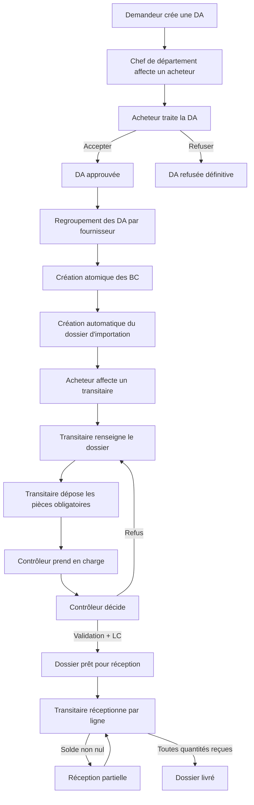

# Étude complète et plan de finalisation — Suivi Process Achat Telecom

## A. RÉSUMÉ EXÉCUTIF (UNE PAGE MAXIMUM)

L’application doit suivre une demande d’achat depuis sa création jusqu’à la réception des marchandises. Le backend Django/DRF couvre déjà une grande partie du chemin métier : demande d’achat, affectation au chef de département puis à l’acheteur, décision de l’acheteur, génération de bons de commande, affectation du transitaire, contrôle documentaire, suivi de la lettre de crédit et réception par ligne avec réception partielle. Les 108 tests backend passent avec SQLite en mémoire et le frontend se compile.

Les fonctionnalités réellement présentes sont principalement les écrans reliés aux demandes, bons de commande, dossiers d’importation, contrôleur, documents obligatoires, notifications et réception. Plusieurs écrans de transport, d’assurance et d’historique sont toutefois des maquettes locales : leurs données ne proviennent pas du backend et leurs modifications ne sont pas enregistrées.

Les principaux risques restant à valider portent sur le parcours réel dans l’interface, les permissions, le stockage documentaire et les informations complémentaires du crédit documentaire. Les écrans Assurance, SuiviTransport et DocumentsTransport ont été retirés; l’historique est désormais alimenté par les dossiers livrés et les réceptions.

Les cinq prochaines actions sont :

1. Vérifier le parcours de saisie et d’affichage des informations LC déjà persistées, sans présenter le contrôleur comme émetteur d’un document bancaire officiel.
2. Vérifier le parcours complet dans l’interface avec des comptes SQLite de test, puis corriger les éventuels blocages frontend/backend.
3. Finaliser la gestion des documents et la cohérence du statut de contrôle, sans modifier les règles métier déjà codées.
4. Compléter, seulement si validé métierlement, les informations facultatives manquantes du crédit documentaire; ne pas créer de nouveau modèle tant que les données existantes ne sont pas insuffisantes.
5. Renforcer les tests bout en bout du processus principal, notamment assignation, génération BC, contrôle, réception complète et réception partielle.

### Mise à jour du 2026-11-04

- **[NOUVEAU]** Depuis la création du rapport sur le commit `074a786`, trois commits frontend ont été ajoutés (`d9721ec`, `bffdd31`, `61c00df`). Le dépôt est propre.
- **[NOUVEAU]** Les écrans Assurance, SuiviTransport et DocumentsTransport ont été supprimés du routage et du dépôt; l’historique utilise désormais les dossiers livrés et les réceptions via API.
- **[NOUVEAU]** Les fallbacks d’utilisateurs, produits, fournisseurs et bons de commande fictifs ont été retirés des écrans admin concernés.
- **[NOUVEAU]** Le crédit documentaire est suivi par trois champs persistés sur le dossier: numéro LC, banque émettrice et date LC. Ce suivi couvre seulement une petite partie du modèle illustratif fourni.
- **[ANCIEN CONSTATS TOUJOURS VALIDES]** Le backend reste DRF/Django, le contrôleur intervient avant expédition, les pièces sont obligatoires avant contrôle, la réception reste par ligne et peut être partielle.

## B. ANALYSE TECHNIQUE

### 0. État actuel du dépôt

#### Photographie du dépôt

- **[CONFIRMÉ]** Le dépôt contient cinq applications métier Django : `authentication`, `demandes`, `produits`, `commandes` et `notifications`.
- **[CONFIRMÉ]** Le frontend est une application React/Vite dans `frontend/`. Les pages principales sont dans `frontend/src/pages/`; les services API dans `frontend/src/services/api.js`; les rôles dans `frontend/src/constants/roles.js`.
- **[CONFIRMÉ]** Les 50 derniers commits du dépôt montrent une finalisation progressive depuis les demandes jusqu’à la réception. Les développements récents importants sont le regroupement DA/BC, le contrôle, les pièces obligatoires, les notifications, la réception par ligne et les tests.
- **[CONFIRMÉ]** Le dépôt n’est pas entièrement propre : deux fichiers non suivis existent : `backend/authentication/management/commands/changer_mots_de_passe.py` et `backend/authentication/test_changer_mots_de_passe.py`. Ces fichiers ne font pas partie du présent rapport.
- **[CONFIRMÉ]** Il existe une CI GitHub Actions dans `.github/workflows/tests.yml`. Elle exécute les tests Django avec SQLite de test factice et construit le frontend.
- **[CONFIRMÉ]** La commande backend autorisée a été exécutée : `cd backend && source .venv/bin/activate && python manage.py test --settings=config.settings_test`.
- **[CONFIRMÉ]** Résultat : 108 tests trouvés et exécutés, 108 réussis, 0 échec; Django ne signale aucune erreur système.
- **[CONFIRMÉ]** La commande frontend `npm run build` dans `frontend/` réussit.

#### Migrations

| Application | Migrations présentes |
|---|---|
| Authentication | 0001_initial à 0004_alter_employe_role |
| Demandes | 0001_initial à 0005_demandeachat_date_assignation |
| Produits | 0001_initial à 0002_remove_produit... |
| Commandes | 0001_initial à 0009_reception_lignereception |
| Notifications | 0001_initial à 0004_alter_notification_type |

**[CONFIRMÉ]** Plusieurs applications ont aussi un répertoire de migrations créé mais incomplet selon le contenu actuel.

#### Commandes de gestion

- **[CONFIRMÉ]** Des commandes de gestion existent pour l’initialisation des employés, le changement de mot de passe et le chargement de données : `backend/authentication/management/commands/`, `backend/commandes/management/commands/`.
- **[CONFIRMÉ]** Le rapport ne déclenche aucune migration ni commande modifiant les données.

### 1. Analyse backend

#### Application `authentication`

- **[CONFIRMÉ]** Le modèle `Employe` contient le nom, prénom, email, mot de passe, rôle, état et département (`backend/authentication/models.py`, lignes 27-65).
- **[CONFIRMÉ]** Les rôles sont administrateur, demandeur, chef de département, acheteur, transitaire, contrôleur et directeur (`backend/authentication/models.py`, lignes 31-39).
- **[CONFIRMÉ]** La connexion est JWT avec endpoints login, logout, utilisateur courant, refresh et CRUD employé (`backend/authentication/urls.py`).
- **[CONFIRMÉ]** Les mots de passe sont hachés avec `set_password()`; l’utilisateur actif est déterminé par l’état de l’employé (`backend/authentication/models.py`, lignes 64-97).
- **[CONFIRMÉ]** La liste des employés est limitée aux administrateurs et aux rôles nécessaires aux affectations. Un chef ne voit que les acheteurs; un acheteur ne voit que les transitaires (`backend/authentication/views.py`, lignes 42-64).
- **[CONFIRMÉ]** Les créations/modifications/suppressions employé sont réservées au mécanisme admin DRF, tandis que la consultation est filtrée par rôle (`backend/authentication/views.py`, lignes 66-78).
- **[À VÉRIFIER]** La personnalisation exacte de `IsAdminUser` avec ce modèle employé personnalisé en dehors des rôles Django doit être vérifiée lors des tests de permissions admin.

#### Application `demandes`

- **[CONFIRMÉ]** La demande possède un identifiant, numéro, DOT, demandeur, acheteur éventuellement affecté, dates, objet et statut `en_cours`, `approuvee` ou `refusee` (`backend/demandes/models.py`, lignes 6-47).
- **[CONFIRMÉ]** Il n’existe pas de statut brouillon. La valeur initiale est `en_cours`.
- **[CONFIRMÉ]** Une ligne de DA contient produit, désignation, quantité et prix unitaire (`backend/demandes/models.py`, lignes 50-77).
- **[CONFIRMÉ]** Un refus est conservé dans `LettreRejet`, avec acheteur, date et motif jusqu’à 500 caractères (`backend/demandes/models.py`, lignes 80-104; `backend/demandes/views.py`, lignes 251-273).
- **[CONFIRMÉ]** Seul le demandeur peut créer une DA; chaque création est atomique et génère un numéro annuel séquentiel (`backend/demandes/views.py`, lignes 93-132).
- **[CONFIRMÉ]** Le demandeur ne peut modifier/supprimer qu’une demande lui appartenant et non encore affectée ni traitée (`backend/demandes/views.py`, lignes 135-173).
- **[CONFIRMÉ]** Seul le chef du département du demandeur peut affecter un acheteur actif (`backend/demandes/views.py`, lignes 177-217).
- **[CONFIRMÉ]** Seul l’acheteur affecté peut accepter ou rejeter (`backend/demandes/views.py`, lignes 229-273).
- **[CONFIRMÉ]** Une demande refusée reste persistée; le modèle `LettreRejet` conserve le motif.
- **[RISQUE À CONFIRMER]** Le filtrage des DA doit être vérifié pour tous les rôles depuis l’API lors d’un scénario avec plusieurs départements.

#### Application `produits`

- **[CONFIRMÉ]** Les modèles `Produit`, `Fournisseur` et catégories sont utilisés par les lignes DA et BC.
- **[CONFIRMÉ]** Les endpoints produits et fournisseurs sont disponibles et les tests de permissions catalogue existent.
- **[À VÉRIFIER]** La couverture fonctionnelle complète des écrans administrateur doit être confirmée visuellement ou par des tests API supplémentaires; le présent rapport ne dispose pas d’un navigateur partagé ni d’une base métier peuplée.

#### Application `commandes`

- **[CONFIRMÉ]** Le `BonDeCommande` est lié à une DA principale et à plusieurs DA via une relation M2M (`backend/commandes/models.py`, lignes 7-31). La DA principale est aussi ajoutée dans `save()`.
- **[CONFIRMÉ]** Un BC contient acheteur, fournisseur, montant et statut `en cours`/`annulé` (`backend/commandes/models.py`, lignes 33-70).
- **[CONFIRMÉ]** Il existe une contrainte d’unicité fournisseur/date/acheteur (`backend/commandes/models.py`, lignes 55-68).
- **[CONFIRMÉ]** Le regroupement et la génération sont réservés à l’acheteur (`backend/commandes/views.py`, lignes 79-96 et 220-263).
- **[CONFIRMÉ]** La génération de plusieurs BC est atomique (`backend/commandes/views.py`, lignes 247-258).
- **[CONFIRMÉ]** Chaque BC créé entraîne la création d’un dossier d’importation (`backend/commandes/views.py`, lignes 205-208).
- **[CONFIRMÉ]** La lecture du BC est filtrée par rôle dans `get_queryset()` (`backend/commandes/views.py`, lignes 274-290).
- **[CONFIRMÉ]** Le dossier contient transitaire, statut opérationnel, statut de contrôle, commentaire, lettre de crédit, autorisation, expédition et réception (`backend/commandes/models.py`, lignes 85-214).
- **[CONFIRMÉ]** Les pièces obligatoires sont facture, colisage, certificat d’origine, titre de transport et assurance selon `backend/commandes/pieces.py`.
- **[CONFIRMÉ]** Les documents ont un type, fichier, nom, date et déposant (`backend/commandes/models.py`, lignes 260-302).
- **[CONFIRMÉ]** Le dossier ne peut être contrôlé que lorsqu’il est renseigné, en cours et que ses pièces obligatoires existent.
- **[CONFIRMÉ]** Le contrôleur peut prendre en charge le dossier, le libérer ou décider; la décision est unique et protégée par verrou (`backend/commandes/views_dossiers.py`, lignes 250-313).
- **[CONFIRMÉ]** Une validation de contrôleur exige un numéro de LC, une banque et une date; la même date ne peut pas être future (`backend/commandes/views_dossiers.py`, lignes 265-279).
- **[CONFIRMÉ]** Une réception correspond à un dossier et à un transitaire; elle contient plusieurs lignes (`backend/commandes/models.py`, lignes 305-365).
- **[CONFIRMÉ]** Les quantités sont verrouillées atomiquement, limitées au reste à recevoir, positivement reçues, et une réception peut être partielle (`backend/commandes/reception.py`, lignes 31-122).
- **[CONFIRMÉ]** La réception complète marque le dossier `livré`, crée la date réelle et déclenche une notification (`backend/commandes/reception.py`, lignes 26-29 et 111-132).
- **[CONFIRMÉ]** Seul le transitaire assigné peut enregistrer une réception (`backend/commandes/views_reception.py`, lignes 55-86).

#### Notifications

- **[CONFIRMÉ]** Les notifications ont leur propre modèle, serializer, vue et endpoint (`backend/notifications/`).
- **[CONFIRMÉ]** Les notifications sont créées lors de la création/assignation, décision DA, affectation du dossier, mise à jour, contrôle, réception et autres transitions principales.
- **[CONFIRMÉ]** La page frontend de notifications utilise réellement l’API (`frontend/src/pages/purchases/Notifications.jsx`).

#### Permissions principales

| Opération | Backend | Frontend |
|---|---|---|
| Créer une DA | Demandeur uniquement, `backend/demandes/views.py` | Autorisé pour demandeur via `roles.js` |
| Affecter un acheteur | Chef du département du demandeur | Page demande accessible selon route et actions conditionnelles |
| Décider d’une DA | Acheteur assigné | Boutons page demande/détails |
| Générer des BC | Acheteur | Pages de regroupement et approuvées |
| Affecter un transitaire | Acheteur propriétaire du BC | Fiche BC |
| Renseigner dossier | Transitaire assigné | Dossier importation |
| Contrôler dossier | Contrôleur | Espace contrôleur dédié |
| Enregistrer réception | Transitaire assigné | Page réception |

**[CONFIRMÉ]** Le routage React redirige vers l’accueil du rôle si la page demandée n’est pas autorisée (`frontend/src/layouts/MainLayout.jsx`, lignes 44-65).

### 2. Frontend

#### Routes principales

Les routes sont déclarées dans `frontend/src/App.jsx` et regroupées selon le rôle. Une protection de route existe côté React, mais les règles de sécurité finales restent côté API.

#### État des pages

| Page | État | Données |
|---|---|---|
| AdminDashboard/AdminDemandes/AdminBC/AdminProduits/AdminFournisseurs/AdminUsers | Partielle/à valider | API principalement; les fallbacks fictifs concernés ont été retirés |
| AdminUsers | API réelle | Liste vide ou erreur visible; pas de données fictives |
| AdminProduits/AdminFournisseurs/AdminBonsCommande | API réelle | Liste vide ou erreur visible; pas de données fictives |
| Login/Profile | Réellement intégrées | Authentification et profil |
| PurchaseRequest / PurchaseRequestList | Implémentée | API demandes |
| FicheDemande | Partielle/implémentée | API demande; actions selon rôle |
| DemandesApprouvées / Regroupement | Implémentée | API approbation/regroupement |
| PurchaseOrder / PurchaseOrderList | Implémentée | API BC |
| FicheBonCommande | Implémentée | API BC, employés, dossier |
| DossiersImportation | Implémentée | API dossiers |
| Dossiers et contrôleur | Implémenté | API dossiers et documents |
| ReceptionColis | Implémentée | API réception par ligne |
| Notifications | Implémentée | API notifications |
| Demandeur/Acheteur/Chef dashboards | Majoritairement API | Comptages et listes backend |
| DocumentsTransport | Retirée | Page supprimée; route retirée |
| Assurances | Retirée | Page supprimée; route retirée |
| SuiviTransport | Retirée | Page supprimée; route retirée |
| Historique | Implémentée sur API | Dossiers livrés et réceptions `/dossiers-importation/`, `/receptions/` |
| TransitaireDashboard | Mixte | Partie API dossiers; libellés et aides peuvent rester locaux |

**[CONFIRMÉ MIS À JOUR]** Les écrans Assurance, SuiviTransport et DocumentsTransport ne sont plus présents dans le routage ni dans le dépôt. L’historique est connecté aux API dossiers et réceptions et ne repose plus sur une constante locale.

**[CONFIRMÉ]** Certaines pages admin remplacent un backend vide ou indisponible par des données de démonstration. Cela masque une API vide et peut faire croire que des données ont été enregistrées alors qu’elles ne le sont pas.

### 3. Processus métier réel



#### Étapes vérifiées

| Étape | Acteur | Avant | Action | Après | Persistance confirmée |
|---|---|---|---|---|---|
| Création DA | Demandeur | — | Créer lignes | `en_cours` | Oui, tests présents |
| Affectation acheteur | Chef département | `en_cours`, sans acheteur | Choisir acheteur | `en_cours`, acheteur fixé | Oui, tests présents |
| Décision acheteur | Acheteur assigné | `en_cours` | Accepter/refuser | `approuvee`/`refusee` | Oui, tests présents |
| Création BC | Acheteur | DA approuvée | Regrouper/générer | BC en cours + dossier | Oui, tests présents |
| Affectation transitaire | Acheteur | Dossier à traiter | Affecter transitaire | Dossier en cours | Oui, tests présents |
| Dépôt pièces | Transitaire | Dossier renseignable | Déposer les pièces obligatoires | Prêt contrôle | Oui, tests documents |
| Contrôle | Contrôleur | `a_verifier` | Valider/refuser | `valide`/`refuse` + LC si valide | Oui, tests contrôle |
| Réception partielle | Transitaire | Contrôle valide, dossier en cours | Recevoir une partie des lignes | Quantités restantes persistées | Oui, tests réception |
| Réception complète | Transitaire | Solde atteint | Recevoir le reste | `livré` + date réelle | Oui, tests réception |

#### Crédit documentaire

- **[CONFIRMÉ]** Le dossier persiste uniquement `numero_lc`, `banque_lc` et `date_lc`; ces champs sont réservés au contrôleur côté sérialiseur et sont saisis avec la décision de validation.
- **[CONFIRMÉ]** Le contrôleur dispose d’un formulaire, d’actions API et d’écrans de consultation. L’API exige numéro, banque et date lors d’une validation, refuse une date future et interdit l’unicité du numéro parmi les dossiers validés.
- **[CONFIRMÉ]** Le frontend affiche les trois informations et fournit une liste de lettres; les libellés « générées »/« transmises » restent trompeurs si aucune confirmation bancaire n’est enregistrée. Ils doivent désigner des informations suivies, non un document bancaire officiel émis par l’application.
- **[CONFIRMÉ]** Des pièces sont déjà téléversables et téléchargeables par type de document, notamment facture, colisage, origine et transport. Des pièces supplémentaires peuvent être déposées via le type `autre`.
- **[À VÉRIFIER]** Montant en chiffres, montant en lettres, devise, objet, pays d’origine/d’expédition, lieu de livraison, dates limites, lieu/date d’expiration, RUU 600, conditions de paiement et liste détaillée des bénéficiaires ne sont pas tous explicitement enregistrés sur le modèle LC. Certaines valeurs peuvent être déduites du BC ou du dossier, mais sans relation/formulaire métier confirmé.
- **[À VALIDER]** Indispensables par opération: référence LC, banque émettrice, donneur d’ordre/applicabilité, bénéficiaire/fournisseur, objet marchandises, devise/montant, pays et livraison, échéances et documents requis. Facultatives selon l’opération: RUU 600, références commerciales détaillées et documents spécifiques. Validation/confirmation bancaire: à suivre séparément si le processus exige une preuve de confirmation; l’application ne signe et ne valide pas au nom de la banque.
- **[RECOMMANDATION]** Utiliser les champs et modèles existants en priorité. Étendre le dossier uniquement pour les données réellement absentes et opérationnelles. Proposer un récapitulatif imprimable ou une vue PDF seulement après validation du contenu; ne pas qualifier ce récapitulatif de lettre de crédit bancaire officielle.

### 4. Acteurs et sécurité métier

| Rôle | Ce qu’il voit | Ce qu’il peut faire | Ce qu’il ne doit pas faire |
|---|---|---|---|
| Demandeur | Ses propres DA et suivis autorisés | Créer/modifier une DA non traitée | Décider, affecter, créer BC, contrôler ou réceptionner |
| Chef département | DA de son département | Affecter le bon acheteur | Décider du niveau acheteur ou créer un BC |
| Acheteur | DA et BC qui lui sont assignés | Accepter/refuser, regrouper, créer BC, affecter transitaire | Modifier une DA autre que celle assignée ou contrôler |
| Transitaire | Dossiers qui lui sont assignés | Renseigner, déposer des pièces, réceptionner | Contrôler son dossier ou recevoir un dossier non assigné |
| Contrôleur | Dossiers prêts | Prendre en charge, valider/refuser, renseigner LC | Renseigner les données métier du transitaire ou réceptionner |
| Administrateur | Employés et données de gestion | Administrer les données autorisées | Non séparé automatiquement des fonctions métier au niveau business |
| Directeur | Consultation historique/admin selon le frontend | Espace limité actuel | [À VÉRIFIER] Ne constitue pas un acteur métier confirmé |

- **[CONFIRMÉ]** Les identités de créations sont associées aux DA, reçus, documents et acheteurs/transitaires selon les modèles concernés.
- **[CONFIRMÉ]** Le contrôleur est enregistré sur le dossier lors de la prise en charge et de la décision.
- **[CONFIRMÉ]** Les opérations métier sensibles sont atomiques ou verrouillées : création DA/lignes, rejet, génération BC, prise en charge, décision et réception.
- **[RISQUE]** Un document supprimé par l’API peut constituer une trace documentaire insuffisante si la politique métier exige l’archivage.
- **[RISQUE]** Les écrans admin de démonstration peuvent être utilisés comme preuve trompeuse de données persistées.
- **[RISQUE]** La sécurité finale doit être vérifiée via des appels API directs, car les routes React ne constituent pas une mesure de sécurité.
- **[CONFIRMÉ]** Les tests backend de permissions, affectations, dossiers, documents, sécurité et réception existent et passent.

### 5. Comparaison ERP / practices d’achat

| Élément | Statut | Utilité pour ce projet |
|---|---|---|
| Demande d’achat | PRÉSENT | Élevée |
| Validation DA sans circuit montant | PRÉSENT | Élevée; règles chef/acheteur adaptées |
| Affectation acheteur | PRÉSENT | Élevée |
| Sourcing/devis | PARTIEL ou ABSENT selon données réelles | Moyenne; le fournisseur est lié au BC mais pas de module devis complet |
| Création BC | PRÉSENT | Élevée |
| Modification/annulation BC | PARTIEL | Moyenne à élevée pour les erreurs opérationnelles |
| Dossier d’importation | PRÉSENT | Élevée |
| Transitaire | PRÉSENT | Élevée |
| Dédouanement | PARTIEL | La tarif douane existe, mais le suivi détaillé est incomplet |
| Autorisation | PARTIEL | Le modèle existe mais la procédure UI/API peut être insuffisante |
| Lettre de crédit | PRÉSENT | Élevée |
| Contrôle documentaire | PRÉSENT | Élevée |
| Expédition | PARTIEL | Les champs mode/lieu/date existent, pas un suivi détaillé en plusieurs étapes |
| Assurance | ABSENT côté backend et écran retiré | Faible tant que ce n’est pas exigé par le contrôle documentaire |
| Réception par ligne | PRÉSENT | Élevée |
| Réception partielle | PRÉSENT | Élevée |
| Rapprochement réception/facture | ABSENT | Faible à moyen, non bloquant pour le processus principal si non décidé |
| Paiement | ABSENT | Hors périmètre fonctionnel actuel |
| Clôture | PARTIEL | Un dossier livré existe sans workflow de clôture comptable |
| Archivage | PARTIEL | Documents fichiers présents; politique d’archivage à préciser |
| Historique/audit | PARTIEL | Dates et identités principales, pas historique complet de chaque modification |
| Reporting | PARTIEL | Dashboards et compteurs, sans reporting analytique complet |
| Notifications | PRÉSENT | Élevée |

### 6. Backlog de finalisation

| Élément | Priorité | Problème constaté | Solution proposée | Backend | Frontend | Dépendance | Taille/Risque |
|---|---|---|---|---|---|---|---|
| Finaliser les écrans LC | P0 | Les trois champs LC existent, mais une partie du dossier d’importation demandé manque et les libellés peuvent laisser croire à un document bancaire officiel | Corriger les libellés, puis ajouter uniquement les champs validés et une vue récapitulative; ne pas générer de lettre de crédit officielle | Étendre sérialiseur/API si validation métier | Formulaire contrôleur et consultation acheteur/transitaire | Validation métier des champs obligatoires/facultatifs | M / Élevé |
| Maquettes transitaire retirées | P0 TERMINÉ | `Assurances`, `SuiviTransport`, `DocumentsTransport` étaient des données locales | Pages et routes retirées; aucun appel fictif conservé | Aucun | Aucun | — | S / Résolu |
| Historique livré réel | P0 TERMINÉ | L’historique était statique | Branché sur dossiers livrés et réceptions | Endpoint dossiers/réceptions existant | `Historique.jsx` | Aucun | S / Résolu |
| Supprimer les fallbacks admin factices | P0 TERMINÉ | Les API admin pouvaient afficher des données fictives | Produits, fournisseurs, utilisateurs et BC concernés utilisent maintenant la réponse API ou une liste vide | Vérifier endpoints admin | Pages admin concernées | Contrat API confirmé | S / Résolu |
| Test bout en bout du chemin principal | P0 | Les tests unitaires existants passent mais le parcours global UI n’est pas automatisé | Ajouter un scénario de validation API ou documenter les appels exacts avec 108 tests | Possibles ajustements mineurs | Corriger bloqueurs navigables | Comptes de test | M / Moyen |
| Boucler réception/affichage | P0 | Plusieurs écrans de suivi peuvent diverger du statut backend | Réutiliser les données dossiers/réceptions et masquer les données locales | Compléter uniquement le champ nécessaire | `ReceptionColis`, `Historique`, dossiers | Modèle réception | M / Moyen |
| Vérifier permissions API réellement appliquées | P1 | Les contrôles frontend ne garantissent pas la sécurité | Ajouter/exécuter des tests d’accès directs par rôle | Tests dans applications | Aucune refonte | P0 sécurité | M / Moyen |
| Sécuriser documents/lifecycle | P1 | Suppression possible selon règles; archive/audit à clarifier | Conserver l’historique des dépôts et empêcher la modification après décision | API documents | `DocumentsPanel`, dossiers | Décision archive/suppression | M / Moyen |
| Finaliser suivi d’autorisation | P1 | Champs présents, workflow utilisateur incomplet | Utiliser les champs existants avant réception | Pas de nouveau modèle nécessaire | Fiche dossier/transitaire | Règle métier validée | S / Moyen |
| Compléter suivi d’expédition utile | P1/P2 | Écrans détaillés retirés; seuls les champs minimum du dossier existent | Limiter au minimum : mode, lieu, date prévue, date réelle déjà persistée | Réutiliser `DossierImportation` | Ne pas réintroduire une maquette; étendre uniquement si besoin validé | Décision métier | M / Moyen |
| Historique réel livraisons | P1 TERMINÉ | Les dossiers livrés et leurs réceptions alimentent désormais l’écran | Maintenir la vue réelle et tester ses filtres/permissions | Endpoint dossier/réception existant | `Historique.jsx` | Aucun | S / Résolu |
| Assurance | P2 | Aucun modèle ni écran persistant | Ne pas développer sans besoin documentaire confirmé | Aucun | Écran retiré; réutiliser un document `assurance` si un besoin apparaît | Décision métier | S / Faible |
| Audit détaillé de modifications | P2 | Peu de champs historiques généraux | N’ajouter que si les responsabilités ou litiges l’exigent | Possibilité de modèle audit ultérieure | Audit consultable | Besoin métier validé | L / Moyen |
| ERP complet (paiement, devis, facture, rapprochement, stock) | Hors périmètre | Absents volontairement | Ne pas développer sans besoin bloquant | Aucun | Aucun | — | L / Élevé |

#### Ordre d’exécution recommandé

1. Valider les champs LC indispensables/facultatifs avec le métier et corriger les libellés trompeurs.
2. Vérifier si les informations déjà disponibles dans BC/dossier évitent une extension; étendre proprement seulement les données manquantes indispensables.
3. Exécuter et corriger le parcours complet avec des données SQLite.
4. Renforcer les permissions API avec des tests par rôle.
5. Valider et terminer le workflow pièces obligatoires, contrôle, autorisation, suivi bancaire et réception.
6. Décider puis implémenter ou documenter une vue récapitulative imprimable du dossier LC, sans fonction d’émission bancaire.
7. Documenter les fonctionnalités intentionally hors périmètre pour éviter qu’elles soient présentées comme terminées.
8. Ajouter les améliorations optionnelles seulement après validation du parcours principal.

### 7. Questions de cadrage métier

1. **Quelles informations du modèle fictif LC sont indispensables à chaque opération, facultatives ou bancaires?**
   **Pourquoi:** Le modèle fourni contient des données commerciales, financières, documentaires et bancaires.
   **Conséquences:** Une extension trop large créerait des doublons; une extension trop faible rendrait le suivi incomplet.
   **Recommandation:** Commencer par une matrice obligatoire/facultative, valider les données bancaires et réutiliser BC/dossier avant toute migration.

2. **La réception doit-elle être déclarée complète automatiquement par la quantité reçue ou doit-elle être aussi validée explicitement par le transitaire?**  
   **Pourquoi:** L’API dispose de réception ligne par ligne et d’un ancien endpoint de validation complète.  
   **Conséquences:** Double double-clic possible sur le bouton total; le backend a les protections nécessaires mais l’expérience doit être clarifiée.  
   **Recommandation:** Réceptionner par lignes; le dossier passe automatiquement à livré lorsque tous les soldes sont atteints.

3. **Peut-on modifier ou supprimer un document déjà pris en compte par le contrôleur?**  
   **Pourquoi:** La suppression et l’historique documentaire ont un impact sur l’intégrité de la décision.  
   **Conséquences:** Une pièce validée pourrait disparaître sans trace.  
   **Recommandation:** Bloquer toute modification/suppression dès validation; conserver un historique ou une pièce remplacée.

4. **L’annulation d’un BC doit-elle être autorisée, et à partir de quel état?**  
   **Pourquoi:** Le modèle contient déjà un statut annulé mais aucune action complète de cycle peut être confirmée.  
   **Conséquences:** Erreurs de saisie et réutilisation des lignes DA.  
   **Recommandation:** Autoriser uniquement tant que le dossier n’est pas contrôlé ou réceptionné.

5. **Quelles pièces sont réellement obligatoires pour chaque type de transport?**  
   **Pourquoi:** La liste backend est globalement obligatoire selon `pieces.py`.  
   **Conséquences:** Certains dossiers peuvent être bloqués inutilement.  
   **Recommandation:** Commencer avec la liste actuelle, puis permettre une liste par mode seulement si le besoin est validé.

### 8. Risques et points de vigilance

| Gravité | Risque | Pourquoi | Correction prioritaire |
|---|---|---|---|
| Critique résiduel réduit | Fausse persistance dans les écrans retirés ou admin | Les fallbacks/mock locaux historiques ont été retirés; validation des autres écrans nécessaire | P0 |
| Élevée | Crédibilité du suivi LC | Une liste intitulée « lettres générées » peut laisser croire à une émission/validation bancaire | P0 |
| Élevée | Informations LC incomplètes | Le modèle fictif contient davantage de données que les trois champs persistés | P0/P1 |
| Élevée | Autorisation métier limitée par le seul frontend | Le routage React doit être doublé de permissions serveur, qui semblent présentes dans les endpoints clés | Tester chaque rôle via API |
| Moyenne | Traçabilité documentaire limitée | Pas d’historique explicitement confirmé pour la modification/suppression | P1 |
| Moyenne | Annulation/modification BC insuffisamment définie | Le statut existe mais le cycle UI/API doit être confirmé | P1/P2 |
| Moyenne | Gestion des fichiers sensible aux migrations de stockage | Les noms sont aléatoires, mais l’hébergement Supabase/PostgreSQL/media doit être vérifié | P1 |
| Moyenne | Contrôle du directeur/rôle admin | Le rôle directeur existe sans acteur métier clairement utilisé | Documenter ou retirer du chemin |
| Faible à moyenne | Dette technique restante | D’autres pages peuvent contenir des simulations locales sans analyse complète de ce rapport ciblé | Nettoyage ciblé |

### 9. Scénario de validation bout en bout

#### Comptes de test

Ne pas reprendre ni inventer de mots de passe réels. Chaque compte doit être créé dans SQLite de test avec un mot de passe explicite et uniquement pour les tests.

- Compte demandeur;
- Compte chef du département correspondant;
- Compte acheteur;
- Compte transitaire;
- Compte contrôleur;
- Compte admin pour les données de référence.

#### Chemin principal

1. Admin crée les utilisateurs, départements, produits et fournisseur.
2. Demandeur se connecte et crée une DA avec au moins deux lignes.
3. Résultat : DA `en_cours`, numéro généré, demandeur identifié, lignes persistées et chef notifié.
4. Chef du département affecte l’acheteur.
5. Résultat : acheteur et date d’affectation enregistrés; acheteur notifié.
6. Acheteur accepte la DA.
7. Résultat : DA `approuvee`, date d’approbation et notification.
8. Acheteur prépare les paniers fournisseurs et génère les BC.
9. Résultat : BC persisté, lignes persistées, DA liées, dossier importation créé.
10. Acheteur affecte un transitaire.
11. Résultat : dossier passe `en_cours`, transitaire notifié.
12. Transitaire renseigne mode, lieu, date prévue et autorisations éventuelles.
13. Transitaire dépose les pièces obligatoires via l’API multipart.
14. Résultat : dossier prêt pour contrôle.
15. Contrôleur prend en charge le dossier.
16. Contrôleur valide, saisit numéro LC, banque et date, et transmet les pièces selon le procédé validé.
17. Résultat : contrôle `valide`, informations de suivi LC persistées, notifications. La banque n’est pas représentée comme validée par l’application sans confirmation métier explicite.
18. Transitaire vérifie les soldes et réceptionne une partie des lignes.
19. Résultat : réception et lignes persistées, dossier reste en cours, soldes et notifications partiels.
20. Transitaire réceptionne le solde restant.
21. Résultat : dossier `livré`, date réelle enregistrée et notification finale.

#### Cas de refus DA

1. Acheteur affecté rejette une DA avec motif.
2. Résultat : statut `refusee`, lettre de rejet, date de rejet et notifications persistées.
3. Toute création ultérieure de BC depuis cette DA doit être interdite.

#### Cas de refus du contrôleur et correction

1. Contrôleur refuse un dossier avec commentaire.
2. Résultat : `statut_controle=refuse`, commentaire et date persistés.
3. Transitaire corrige le dossier et les pièces nécessaires.
4. Résultat : dossier reprend `a_verifier`, contrôleur libéré, notifications de mise à jour.

#### Ce qui est déjà vérifié

- 108 tests backend SQLite passent.
- Frontend compile.
- Backend couvre la réception partielle, le contrôle, les documents et les permissions dans les tests présents.

#### Ce qui nécessite validation supplémentaire

- Parcours React réel avec données enregistrées;
- Pages statiques retirées/corrigées;
- Accès direct à tous les endpoints par chaque rôle;
- Stockage réel des documents hors test;
- Parcours d’autorisation et annulation BC.

## C. CE QUI RESTE À FAIRE

1. **État des fausses données fictives.** Les écrans transitaire retirés et les fallbacks admin concernés ont été nettoyés; vérifier les autres écrans avant livraison.
2. **Finaliser le périmètre LC.** Valider les données indispensables/facultatives, étendre le modèle seulement si nécessaire et corriger les libellés d’émission/validation bancaire.
3. **Tester le parcours complet UI/API.** Corriger les appels, routes et champs qui empêchent une utilisation bout en bout.
4. **Finaliser les permissions.** Vérifier chaque endpoint avec chaque rôle par des tests API directs.
5. **Historique réel.** Branché sur les dossiers livrés et leurs réceptions; vérifier le parcours réel avec données.
6. **Clarifier annulation, autorisation et documents.** Utiliser les champs existants et protéger les transitions.
7. **Ajouter uniquement les améliorations P2 validées.** Aucun module ERP étendu n’est nécessaire pour finaliser le chemin principal.

## D. CE QUI N’A PAS PU ÊTRE VÉRIFIÉ

- **[À VÉRIFIER]** L’interface n’a pas été parcourue dans un navigateur partagé avec des comptes et données réelles depuis la mise à jour.
- **[À VÉRIFIER]** La base PostgreSQL/Supabase réelle n’a pas été consultée ni modifiée, conformément aux contraintes.
- **[À VÉRIFIER]** Le stockage et la conservation des fichiers uploadés sur Supabase ou sur le média actuel.
- **[À VÉRIFIER]** Toutes les pages frontend n’ont pas été parcourues individuellement dans ce rapport ciblé.
- **[À VÉRIFIER]** Les informations complémentaires du modèle fictif LC n’ont pas été confirmées comme données obligatoires, facultatives ou bancaires par un responsable métier.
- **[À VÉRIFIER]** Le mécanisme réel de confirmation bancaire n’est pas connu; aucun workflow bancaire officiel n’a été inferred de l’application.
- **[À VÉRIFIER]** Le comportement exact de `IsAdminUser` sur le modèle employé personnalisé.
- **[À VÉRIFIER]** Les données et configurations réelles du backend, notamment la disponibilité PostgreSQL, ne sont pas confirmées dans ce rapport.
- **[À VÉRIFIER]** Aucun secret, mot de passe, clé ou chaîne de connexion n’a été lu ou écrit dans ce rapport.
- **[À VÉRIFIER]** Le fonctionnement visuel après un changement d’API n’a pas été testé hors build.

## E. PROMPT DE PASSATION POUR LA SUITE DU DÉVELOPPEMENT

```text
Contexte : application web « Suivi Process Achat Telecom » Django REST + React/Vite/Tailwind.
Objectif : terminer le parcours réel demandé, sans construire d’ERP complet.

Règles métier impératives :
- Le demandeur crée seul une DA.
- Pas de statut brouillon DA.
- Une DA refusée est définitive.
- Le chef de département affecte un acheteur.
- L’acheteur accepte/rejette une DA affectée; aucun circuit fondé sur le montant.
- Le contrôleur intervient avant expédition et vérifie les pièces obligatoires plus la LC.
- La réception est par ligne et peut être partielle.
- Chaque rôle est responsable uniquement de ses actions métier.

Architecture confirmée :
- backend/authentication : employés, rôles, JWT.
- backend/demandes : DA, lignes, lettres de rejet.
- backend/produits : produits/fournisseurs.
- backend/commandes : BC, dossiers, documents, contrôle, réception.
- backend/notifications : notifications.
- frontend/src/pages : écrans métier.
- frontend/src/services/api.js : client API.
- frontend/src/constants/roles.js : navigation et accès frontend.

État confirmé :
- 108 tests backend passent avec settings=config.settings_test.
- Frontend npm run build passe.
- Pipeline confirmé DA -> affectation -> décision -> BC -> dossier -> transitaire -> pièces -> contrôle/saisie LC -> validation par le contrôleur -> réception partielle/complète.
- Notifications principales présentes.
- Les pages Assurance, SuiviTransport et DocumentsTransport ont été retirées; l’historique est connecté aux dossiers livrés et réceptions.
- Les fallbacks admin fictifs concernés ont été retirés.
- Le suivi LC actuel ne couvre que numéro, banque émettrice et date.

Bugs/priorités à corriger :
1. Valider les données LC à suivre; étendre le dossier seulement pour les informations indispensables absentes.
2. Corriger les libellés LC et ne pas représenter l’application comme émettrice ou approbatrice de la lettre.
3. Parcourir l’application avec données SQLite réelles et corriger les bloqueurs UI/API.
4. Vérifier les permissions API par rôle avec tests directs.
5. Clarifier annulation BC, suppression/remplacement de document et autorisation.
6. Décider d’une vue récapitulative imprimable, puis l’implémenter sans génération bancaire officielle.

Fichiers à examiner en premier :
- backend/demandes/views.py
- backend/demandes/models.py
- backend/commandes/views.py
- backend/commandes/views_dossiers.py
- backend/commandes/views_documents.py
- backend/commandes/reception.py
- backend/commandes/views_reception.py
- backend/authentication/views.py
- frontend/src/App.jsx
- frontend/src/layouts/MainLayout.jsx
- frontend/src/constants/roles.js
- frontend/src/pages/purchases/Historique.jsx
- frontend/src/pages/controleur/ControleurDossiers.jsx
- frontend/src/pages/controleur/ControleurLettres.jsx
- frontend/src/pages/admin/*.jsx

Tests :
cd backend && source .venv/bin/activate && python manage.py test --settings=config.settings_test
cd frontend && npm run build

Contraintes :
- Ne modifier aucune règle métier sans justification et validation.
- Ne pas ajouter ERP/paiement/facturation/refonte générale tant que le parcours principal n’est pas validé.
- Préserver les fonctionnalités opérationnelles confirmées.
- Protéger les opérations côté backend; le frontend ne constitue pas une autorisation.
- Utiliser les modèles existants avant d’en créer de nouveaux.
- Tester chaque modification immédiatement avec la plus petite commande pertinente.
- Expliquer les changements à une développeuse débutante Django/React/PostgreSQL.
```
